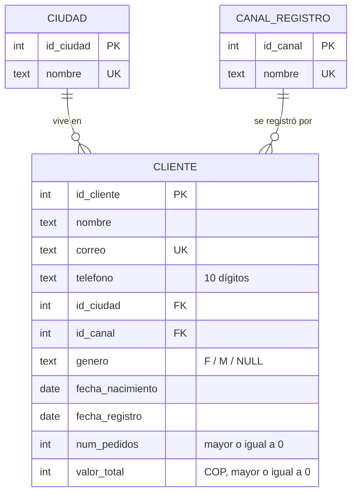
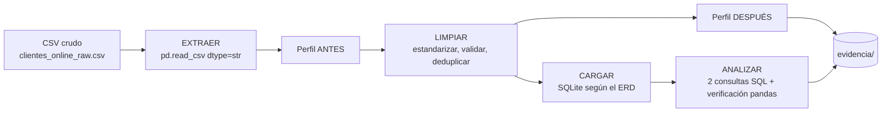

# Calidad de datos: limpieza y evidencia antes/después

> **Caso:** cadena de tiendas de ropa con sedes en Neiva, Bogotá, Medellín y Cali. Se trabaja con los **clientes de la tienda en línea**, la fuente que llega con más problemas de calidad (formularios escritos a mano, registros repetidos y formatos mezclados).
> **Requisito:** datos limpios + 2 análisis con consultas.

---

## 1. Modelo de datos (ERD)

El CSV llega "plano" (ciudad y canal repetidos como texto en cada fila). Se normaliza en tres tablas para que ciudad y canal sean catálogos controlados.



**Decisiones del modelo**

- Una ciudad tiene muchos clientes y un canal tiene muchos clientes (relaciones 1:N).
- `correo UNIQUE` evita duplicados; los `CHECK` validan teléfono (10 dígitos), género (`F`/`M`), `num_pedidos >= 0` y `valor_total >= 0`. Son una segunda línea de defensa: si la limpieza fallara, la base rechaza el dato.
- Una extensión natural sería una tabla `PEDIDO`; aquí `num_pedidos` y `valor_total` vienen ya agregados en la fuente.

**DDL (`sql/01_schema.sql`)**

```sql
PRAGMA foreign_keys = ON;
CREATE TABLE IF NOT EXISTS ciudad (
  id_ciudad INTEGER PRIMARY KEY,
  nombre    TEXT NOT NULL UNIQUE
);
CREATE TABLE IF NOT EXISTS canal_registro (
  id_canal INTEGER PRIMARY KEY,
  nombre   TEXT NOT NULL UNIQUE
);
CREATE TABLE IF NOT EXISTS cliente (
  id_cliente       INTEGER PRIMARY KEY,
  nombre           TEXT NOT NULL,
  correo           TEXT UNIQUE,
  telefono         TEXT CHECK (telefono IS NULL OR length(telefono) = 10),
  id_ciudad        INTEGER REFERENCES ciudad(id_ciudad),
  id_canal         INTEGER REFERENCES canal_registro(id_canal),
  genero           TEXT CHECK (genero IN ('F','M') OR genero IS NULL),
  fecha_nacimiento TEXT,
  fecha_registro   TEXT,
  num_pedidos      INTEGER NOT NULL DEFAULT 0 CHECK (num_pedidos >= 0),
  valor_total      INTEGER CHECK (valor_total IS NULL OR valor_total >= 0)
);
```

---

## 2. Carga y limpieza en pandas

### 2.1 Dataset (CSV)

`data/raw/clientes_online_raw.csv`: **445 filas × 11 columnas**. Es un dataset **sintético** (sin personas reales) con los problemas típicos de un formulario web inyectados a propósito.

| Columna | Descripción | Problemas |
|---|---|---|
| `id_cliente` | Identificador | Ids distintos para el mismo cliente |
| `nombre` | Nombre completo | MAYÚSCULAS, minúsculas, espacios dobles |
| `correo` | Email | Inválidos (`n/a`, `juan@@gmail`), nulos, mayúsculas |
| `telefono` | Celular | `+57 315 381 4474`, `315-381-4474`, `57315...` |
| `ciudad` | Ciudad | 20 variantes de solo 4 ciudades |
| `fecha_registro` | Alta | 7 formatos mezclados |
| `fecha_nacimiento` | Nacimiento | Imposibles (año 1850, 2031), nulos |
| `genero` | Género | `F`, `f`, `Femenino`, `mujer`... |
| `canal_registro` | web / app / redes sociales / referido | Nulos |
| `num_pedidos` | Pedidos | — |
| `valor_total` | Total comprado (COP) | `$1.250.000` vs `1250000`, negativos |

Se agregaron además **25 duplicados exactos** y **20 duplicados disfrazados** (mismo correo en mayúsculas, otro `id_cliente`, nombre con otro formato).

<details>
<summary>Código que genera el CSV sucio (<code>src/generar_datos.py</code>)</summary>

```python
"""Genera un CSV sintetico y 'sucio' de clientes de la tienda en linea (reproducible, seed=42)."""
import random
import pandas as pd

random.seed(42)
N = 400
nombres = ["Juan", "María", "Carlos", "Laura", "Andrés", "Camila", "Santiago", "Valentina", "Daniel",
           "Sofía", "Felipe", "Daniela", "Sebastián", "Paula", "Julián", "Natalia", "Miguel", "Luisa"]
apellidos = ["Gómez", "Rodríguez", "Martínez", "López", "García", "Pérez", "Ramírez", "Torres",
             "Vargas", "Castro", "Rojas", "Moreno", "Muñoz", "Díaz", "Ortiz", "Cardona"]
ciudades = ["Neiva", "Bogotá", "Medellín", "Cali"]
canales = ["web", "app", "redes sociales", "referido"]
variantes_ciudad = {
    "Neiva": ["Neiva", "neiva", "NEIVA", "Neiva ", "Neiva - Huila"],
    "Bogotá": ["Bogotá", "bogota", "BOGOTA", "Bogotá D.C.", "Bogota "],
    "Medellín": ["Medellín", "medellin", "MEDELLIN", "Medellin ", "Medellín - Ant"],
    "Cali": ["Cali", "cali", "CALI", "Cali ", "Santiago de Cali"],
}
variantes_genero = {"F": ["F", "f", "Femenino", "mujer", "Mujer"], "M": ["M", "m", "Masculino", "hombre", "Hombre"]}

rows = []
for i in range(1, N + 1):
    n, a1, a2 = random.choice(nombres), random.choice(apellidos), random.choice(apellidos)
    ciudad = random.choice(ciudades)
    g = random.choice(["F", "M"])
    correo = f"{n}.{a1}{i}@{random.choice(['gmail.com','hotmail.com','outlook.com'])}".lower()
    correo = correo.replace("á","a").replace("é","e").replace("í","i").replace("ó","o").replace("ú","u").replace("ñ","n")
    tel = "3" + "".join(random.choice("0123456789") for _ in range(9))
    tel = random.choice([tel, f"+57 {tel[:3]} {tel[3:6]} {tel[6:]}", f"{tel[:3]}-{tel[3:6]}-{tel[6:]}", f"57{tel}", tel])
    y, m, d = random.randint(2023, 2025), random.randint(1, 12), random.randint(1, 28)
    reg = random.choice([f"{y}-{m:02d}-{d:02d}", f"{d:02d}/{m:02d}/{y}", f"{d}-{m}-{y}", f"{y}/{m:02d}/{d:02d}"])
    by, bm, bd = random.randint(1960, 2006), random.randint(1, 12), random.randint(1, 28)
    nac = random.choice([f"{by}-{bm:02d}-{bd:02d}", f"{bd:02d}/{bm:02d}/{by}"])
    npedidos = random.choice([0, 0, 1, 1, 2, 3, 4, 5, 8])
    valor = npedidos * random.randint(60, 350) * 1000
    valor_s = random.choice([str(valor), f"${valor:,}".replace(",", ".")]) if valor else "0"
    rows.append({
        "id_cliente": i,
        "nombre": f"{n} {a1} {a2}",
        "correo": correo,
        "telefono": tel,
        "ciudad": random.choice(variantes_ciudad[ciudad]),
        "fecha_registro": reg,
        "fecha_nacimiento": nac,
        "genero": random.choice(variantes_genero[g]),
        "canal_registro": random.choice(canales),
        "num_pedidos": npedidos,
        "valor_total": valor_s,
    })

df = pd.DataFrame(rows)
# --- Ensuciar ---
# nombres escritos a mano: espacios dobles, mayusculas/minusculas
idx = df.sample(frac=0.25, random_state=1).index
df.loc[idx, "nombre"] = df.loc[idx, "nombre"].apply(lambda s: random.choice([s.upper(), s.lower(), "  " + s.replace(" ", "  ") + " "]))
# nulos
for col, frac in [("correo", 0.05), ("telefono", 0.08), ("fecha_nacimiento", 0.07), ("genero", 0.06), ("canal_registro", 0.04), ("ciudad", 0.03)]:
    df.loc[df.sample(frac=frac, random_state=hash(col) % 1000).index, col] = None
# correos invalidos
bad = df[df["correo"].notna()].sample(18, random_state=3).index
df.loc[bad, "correo"] = [random.choice(["sin correo", "juan@@gmail", "maria.gmail.com", "carlos@hotmail", "n/a", "pedro @gmail.com"]) for _ in bad]
# fechas de nacimiento imposibles
df.loc[df.sample(8, random_state=5).index, "fecha_nacimiento"] = ["1900-01-01", "2030-05-10", "01/01/1850", "2015-03-03", "2024-01-01", "1899-12-31", "2031-01-01", "1905-06-06"]
# valores negativos
df.loc[df.sample(6, random_state=7).index, "valor_total"] = "-50000"
# registros repetidos: exactos y casi-exactos (mismo correo con otro formato)
exact = df.sample(25, random_state=11)
near = df[df["correo"].notna()].sample(20, random_state=13).copy()
near["id_cliente"] = range(1001, 1021)
near["correo"] = near["correo"].str.upper()
near["nombre"] = near["nombre"].str.title().str.replace(" ", "  ", n=1)
df = pd.concat([df, exact, near], ignore_index=True).sample(frac=1, random_state=21).reset_index(drop=True)
df.to_csv("data/raw/clientes_online_raw.csv", index=False, encoding="utf-8")
print("CSV generado:", df.shape)
```

</details>

### 2.2 Reglas de limpieza

| # | Problema | Regla | Antes → Después |
|---|---|---|---|
| 1 | Espacios y mayúsculas en nombres | `strip` + colapsar espacios + `title()` | `"  JUAN  GÓMEZ "` → `Juan Gómez` |
| 2 | Ciudad escrita de 20 formas | Quitar tildes, minúsculas, mapear a las 4 sedes | `"Bogotá D.C."`, `"BOGOTA "` → `Bogotá` |
| 3 | Género con 10 variantes | Diccionario a `F` / `M` | `"mujer"`, `"Femenino"` → `F` |
| 4 | Correos inválidos o en mayúsculas | `lower` + regex; inválido → nulo | `"juan@@gmail"` → `NULL` |
| 5 | Teléfonos con formatos mezclados | Solo dígitos, quitar prefijo `57`, exigir 10 dígitos que inicien en `3` | `"+57 315 381 4474"` → `3153814474` |
| 6 | Fechas en 7 formatos | Parseo explícito → `YYYY-MM-DD` | `"16-4-2024"` → `2024-04-16` |
| 7 | Nacimiento imposible | Edad < 18 o > 100 → nulo | `"01/01/1850"` → `NULL` |
| 8 | Montos como texto con `$` y puntos | Quitar símbolos → entero | `"$585.000"` → `585000` |
| 9 | Montos negativos | No puede ser < 0 → nulo | `-50000` → `NULL` |
| 10 | Duplicados exactos | `drop_duplicates()` | 25 filas eliminadas |
| 11 | Duplicados por correo | Por correo normalizado, conservar el registro **más completo** | 20 filas eliminadas |

**Decisión clave:** si un valor es inválido no se inventa una corrección: se marca como `NULL`. Por eso los nulos pueden subir un poco tras limpiar; antes eran valores falsos escondidos.

### 2.3 Evidencia antes / después

Generada por el pipeline en `evidencia/reporte_calidad_antes_despues.csv`.

| Métrica de calidad | Antes | Después |
|---|---:|---:|
| Filas | 445 | **400** |
| Duplicados exactos | 25 | **0** |
| Correos repetidos (normalizados) ¹ | 53 | **0** |
| Correos con formato inválido | 15 | **0** |
| Ciudades distintas (reales: 4) | 20 | **4** |
| Valores distintos de género (reales: 2) | 10 | **2** |
| Formatos distintos de `fecha_registro` | 7 | **1** |
| Montos negativos | 7 | **0** |
| Fechas de nacimiento imposibles | 8 | **0** |
| Nulos totales ² | 153 | 164 |

¹ Incluye marcadores repetidos como `"n/a"`, que luego pasan a nulo.
² Sube porque los valores inválidos pasan a `NULL`.

**Ejemplo fila a fila**

| | id | ciudad | fecha_registro | género | valor_total |
|---|---|---|---|---|---|
| Antes | 41 | `neiva` | `19/04/2025` | `m` | `0` |
| Después | 41 | `Neiva` | `2025-04-19` | `M` | `0` |
| Antes | 141 | `Bogotá D.C.` | `2024-06-20` | `F` | `$585.000` |
| Después | 141 | `Bogotá` | `2024-06-20` | `F` | `585000` |
| Antes | 240 | `Neiva ` | `16-4-2024` | *(vacío)* | `789000` |
| Después | 240 | `Neiva` | `2024-04-16` | `NULL` | `789000` |

### 2.4 Código completo del pipeline (`src/pipeline.py`)

```python
"""Pipeline: EXTRAER -> LIMPIAR -> CARGAR (SQLite) -> ANALIZAR. Genera evidencia antes/despues."""
import re, sqlite3, unicodedata
from datetime import date
import pandas as pd

RAW = "data/raw/clientes_online_raw.csv"
HOY = pd.Timestamp("2026-10-08")
EMAIL_RE = re.compile(r"^[a-z0-9._%+-]+@[a-z0-9.-]+\.[a-z]{2,}$")

# ---------- 1. EXTRAER ----------
def extraer(ruta):
    return pd.read_csv(ruta, dtype=str, keep_default_na=True)

# ---------- utilidades ----------
def sin_tildes(s):
    return "".join(c for c in unicodedata.normalize("NFD", s) if unicodedata.category(c) != "Mn")

def parse_fecha(s):
    if pd.isna(s): return pd.NaT
    s = s.strip()
    for fmt in ("%Y-%m-%d", "%Y/%m/%d", "%d/%m/%Y", "%d-%m-%Y"):
        try: return pd.to_datetime(s, format=fmt)
        except ValueError: continue
    return pd.NaT

def norm_ciudad(s):
    if pd.isna(s): return None
    t = sin_tildes(s).lower().strip()
    if t.startswith("neiva"): return "Neiva"
    if t.startswith("bogota"): return "Bogotá"
    if t.startswith("medellin"): return "Medellín"
    if "cali" in t: return "Cali"
    return None

def norm_genero(s):
    if pd.isna(s): return None
    t = s.strip().lower()
    if t in ("f", "femenino", "mujer"): return "F"
    if t in ("m", "masculino", "hombre"): return "M"
    return None

def norm_tel(s):
    if pd.isna(s): return None
    d = re.sub(r"\D", "", s)
    if len(d) == 12 and d.startswith("57"): d = d[2:]
    return d if (len(d) == 10 and d.startswith("3")) else None

def norm_valor(s):
    if pd.isna(s): return None
    v = re.sub(r"[^\d-]", "", s)          # quita $, puntos y espacios
    return int(v) if v not in ("", "-") and int(v) >= 0 else None

def norm_correo(s):
    if pd.isna(s): return None
    c = s.strip().lower()
    return c if EMAIL_RE.match(c) else None

# ---------- perfil de calidad ----------
def perfil(df, etapa):
    m = {"etapa": etapa, "filas": len(df)}
    m["duplicados_exactos"] = int(df.duplicated().sum())
    corr = df["correo"].dropna().str.strip().str.lower()
    m["duplicados_por_correo"] = int(corr.duplicated().sum())
    m["nulos_totales"] = int(df.isna().sum().sum())
    for c in ["correo", "telefono", "ciudad", "genero", "fecha_nacimiento", "canal_registro"]:
        m[f"nulos_{c}"] = int(df[c].isna().sum())
    m["correos_invalidos"] = int(corr[~corr.str.match(EMAIL_RE)].shape[0]) if etapa == "ANTES" else int(df["correo"].notna().sum() - df["correo"].dropna().str.match(EMAIL_RE).sum())
    m["valores_ciudad_distintos"] = int(df["ciudad"].dropna().nunique())
    m["valores_genero_distintos"] = int(df["genero"].dropna().nunique())
    if etapa == "ANTES":
        m["telefonos_formato_invalido"] = int(df["telefono"].dropna().apply(lambda s: norm_tel(s) is None).sum())
        m["valores_negativos"] = int(df["valor_total"].dropna().str.startswith("-").sum())
        nac = df["fecha_nacimiento"].apply(parse_fecha)
        edad = (HOY - nac).dt.days / 365.25
        m["fechas_nac_imposibles"] = int(((edad < 18) | (edad > 100)).sum())
        m["formatos_fecha_registro"] = int(df["fecha_registro"].dropna().str.replace(r"\d", "9", regex=True).nunique())
    else:
        m["telefonos_formato_invalido"] = int(df["telefono"].dropna().apply(lambda s: norm_tel(s) is None).sum())
        m["valores_negativos"] = int((df["valor_total"].dropna() < 0).sum())
        edad = (HOY - df["fecha_nacimiento"]).dt.days / 365.25
        m["fechas_nac_imposibles"] = int(((edad < 18) | (edad > 100)).sum())
        m["formatos_fecha_registro"] = 1
    return m

# ---------- 2. LIMPIAR ----------
def limpiar(df):
    d = df.copy()
    d["id_cliente"] = d["id_cliente"].astype(int)
    d["nombre"] = d["nombre"].str.strip().str.replace(r"\s+", " ", regex=True).str.title()
    d["correo"] = d["correo"].apply(norm_correo)
    d["telefono"] = d["telefono"].apply(norm_tel)
    d["ciudad"] = d["ciudad"].apply(norm_ciudad)
    d["genero"] = d["genero"].apply(norm_genero)
    d["canal_registro"] = d["canal_registro"].str.strip().str.lower()
    d["fecha_registro"] = d["fecha_registro"].apply(parse_fecha)
    d["fecha_nacimiento"] = d["fecha_nacimiento"].apply(parse_fecha)
    edad = (HOY - d["fecha_nacimiento"]).dt.days / 365.25
    d.loc[(edad < 18) | (edad > 100), "fecha_nacimiento"] = pd.NaT   # imposible -> nulo (no inventamos)
    d["num_pedidos"] = d["num_pedidos"].astype(int)
    d["valor_total"] = d["valor_total"].apply(norm_valor).astype("Int64")
    # deduplicar: 1) exactos  2) mismo correo valido -> conservar el mas completo
    d = d.drop_duplicates()
    d["_completitud"] = d.notna().sum(axis=1)
    d = d.sort_values(["_completitud", "id_cliente"], ascending=[False, True])
    con_correo = d[d["correo"].notna()].drop_duplicates(subset="correo", keep="first")
    sin_correo = d[d["correo"].isna()].drop_duplicates(subset=["nombre", "fecha_nacimiento", "ciudad"], keep="first")
    d = pd.concat([con_correo, sin_correo]).drop(columns="_completitud").sort_values("id_cliente").reset_index(drop=True)
    return d

# ---------- 3. CARGAR (modelo relacional) ----------
def cargar(df, ruta_db="data/clean/tienda.db"):
    con = sqlite3.connect(ruta_db)
    con.executescript(open("sql/01_schema.sql", encoding="utf-8").read())
    con.execute("DELETE FROM cliente"); con.execute("DELETE FROM ciudad"); con.execute("DELETE FROM canal_registro")
    for i, c in enumerate(["Neiva", "Bogotá", "Medellín", "Cali"], 1):
        con.execute("INSERT INTO ciudad VALUES (?,?)", (i, c))
    for i, c in enumerate(["web", "app", "redes sociales", "referido"], 1):
        con.execute("INSERT INTO canal_registro VALUES (?,?)", (i, c))
    ciu = {r[1]: r[0] for r in con.execute("SELECT * FROM ciudad")}
    can = {r[1]: r[0] for r in con.execute("SELECT * FROM canal_registro")}
    filas = []
    for r in df.itertuples():
        filas.append((r.id_cliente, r.nombre, r.correo, r.telefono, ciu.get(r.ciudad), can.get(r.canal_registro),
                      r.genero, None if pd.isna(r.fecha_nacimiento) else r.fecha_nacimiento.strftime("%Y-%m-%d"),
                      None if pd.isna(r.fecha_registro) else r.fecha_registro.strftime("%Y-%m-%d"),
                      r.num_pedidos, None if pd.isna(r.valor_total) else int(r.valor_total)))
    con.executemany("INSERT INTO cliente VALUES (?,?,?,?,?,?,?,?,?,?,?)", filas)
    con.commit()
    return con

# ---------- 4. ANALIZAR ----------
def analizar(con, df):
    q1 = open("sql/02_q1_ingresos_por_ciudad.sql", encoding="utf-8").read()
    q2 = open("sql/03_q2_ticket_por_canal.sql", encoding="utf-8").read()
    r1 = pd.read_sql(q1, con); r2 = pd.read_sql(q2, con)
    # Version pandas (verificacion cruzada)
    p1 = (df[df["ciudad"].notna()].groupby("ciudad")
          .agg(clientes=("id_cliente", "count"), clientes_con_compra=("num_pedidos", lambda s: (s > 0).sum()),
               ingresos=("valor_total", "sum")).sort_values("ingresos", ascending=False).reset_index())
    act = df[(df["num_pedidos"] > 0) & df["valor_total"].notna() & df["canal_registro"].notna()]
    p2 = (act.groupby("canal_registro").agg(clientes=("id_cliente", "count"), pedidos=("num_pedidos", "sum"),
          ingresos=("valor_total", "sum")).reset_index())
    p2["ticket_promedio"] = (p2["ingresos"] / p2["pedidos"]).round(0)
    p2 = p2.sort_values("ticket_promedio", ascending=False).reset_index(drop=True)
    assert list(r1["ciudad"]) == list(p1["ciudad"]) and list(r1["ingresos"]) == list(p1["ingresos"].astype(int)), "Q1 SQL != pandas"
    assert list(r2["canal"]) == list(p2["canal_registro"]), "Q2 SQL != pandas"
    return r1, r2

if __name__ == "__main__":
    raw = extraer(RAW)
    antes = perfil(raw, "ANTES")
    limpio = limpiar(raw)
    despues = perfil(limpio, "DESPUES")
    rep = pd.DataFrame([antes, despues]).set_index("etapa").T
    rep.to_csv("evidencia/reporte_calidad_antes_despues.csv")
    print(rep.to_string())
    limpio.to_csv("data/clean/clientes_limpio.csv", index=False, encoding="utf-8")
    con = cargar(limpio)
    r1, r2 = analizar(con, limpio)
    r1.to_csv("evidencia/q1_ingresos_por_ciudad.csv", index=False); r2.to_csv("evidencia/q2_ticket_por_canal.csv", index=False)
    print("\nQ1\n", r1.to_string(index=False)); print("\nQ2\n", r2.to_string(index=False))
    print("\nMuestra ANTES vs DESPUES (ids 41, 141, 240):")
    ids = [41, 141, 240]
    print(raw[raw.id_cliente.isin([str(i) for i in ids])].drop(columns=["correo"]).to_string(index=False))
    print(limpio[limpio.id_cliente.isin(ids)].drop(columns=["correo"]).to_string(index=False))
```

---

## 3. Preguntas respondidas con consultas

Cada consulta usa **filtro + agregación**, está escrita en **SQL** y verificada en **pandas**; el pipeline incluye un `assert` que confirma que ambos métodos dan el mismo resultado.

### Pregunta 1: ¿Qué ciudad genera más ingresos online y cuántos clientes compran?

```sql
-- Q1: ¿Qué sede/ciudad aporta más ingresos online y cuántos clientes compran?
SELECT ci.nombre                                  AS ciudad,
       COUNT(*)                                   AS clientes,
       SUM(CASE WHEN c.num_pedidos > 0 THEN 1 ELSE 0 END) AS clientes_con_compra,
       SUM(c.valor_total)                         AS ingresos
FROM cliente c
JOIN ciudad ci ON ci.id_ciudad = c.id_ciudad
GROUP BY ci.nombre
ORDER BY ingresos DESC;
```

```python
(df[df["ciudad"].notna()].groupby("ciudad")
   .agg(clientes=("id_cliente", "count"),
        clientes_con_compra=("num_pedidos", lambda s: (s > 0).sum()),
        ingresos=("valor_total", "sum"))
   .sort_values("ingresos", ascending=False))
```

| Ciudad | Clientes | Con compra | Ingresos (COP) |
|---|---:|---:|---:|
| Medellín | 101 | 78 | 57.456.000 |
| Bogotá | 94 | 76 | 56.752.000 |
| Cali | 92 | 78 | 48.604.000 |
| Neiva | 101 | 74 | 45.115.000 |

**Lectura:** Medellín y Bogotá lideran con ingresos muy parejos. Neiva tiene tantos clientes registrados como Medellín (101) pero es la que menos ingresa: hay oportunidad de conversión en Neiva.

### Pregunta 2: Entre quienes sí compraron, ¿qué canal de registro tiene el mayor ticket promedio?

Filtro: `num_pedidos > 0` y monto válido. Ticket promedio = ingresos ÷ pedidos.

```sql
-- Q2: Entre clientes que SÍ compraron, ¿qué canal de registro tiene mayor ticket promedio?
SELECT cr.nombre                                  AS canal,
       COUNT(*)                                   AS clientes,
       SUM(c.num_pedidos)                         AS pedidos,
       SUM(c.valor_total)                         AS ingresos,
       ROUND(1.0 * SUM(c.valor_total) / SUM(c.num_pedidos)) AS ticket_promedio
FROM cliente c
JOIN canal_registro cr ON cr.id_canal = c.id_canal
WHERE c.num_pedidos > 0 AND c.valor_total IS NOT NULL
GROUP BY cr.nombre
ORDER BY ticket_promedio DESC;
```

```python
act = df[(df["num_pedidos"] > 0) & df["valor_total"].notna() & df["canal_registro"].notna()]
res = act.groupby("canal_registro").agg(pedidos=("num_pedidos", "sum"), ingresos=("valor_total", "sum"))
res["ticket_promedio"] = (res["ingresos"] / res["pedidos"]).round()
```

| Canal | Clientes | Pedidos | Ingresos (COP) | Ticket promedio |
|---|---:|---:|---:|---:|
| app | 76 | 221 | 49.910.000 | **225.837** |
| web | 73 | 251 | 50.986.000 | 203.131 |
| redes sociales | 74 | 292 | 54.945.000 | 188.168 |
| referido | 75 | 231 | 41.412.000 | 179.273 |

**Lectura:** la app tiene el ticket más alto; redes sociales genera más pedidos pero de menor valor.

> Con los datos crudos, la pregunta 1 habría repartido los clientes en 20 "ciudades", habría contado dos veces a los duplicados y los montos como `$1.250.000` (texto) ni siquiera se habrían podido sumar.

---

## 4. Datos listos y flujo documentado (extraer → limpiar → analizar)



| Etapa | Qué se hace | Dónde |
|---|---|---|
| **Extraer** | Leer el CSV todo como texto, para que pandas no adivine tipos ni pierda formatos antes de medirlos | `extraer()` |
| **Limpiar** | Medir calidad (antes), aplicar las 11 reglas, medir de nuevo (después) | `perfil()`, `limpiar()` |
| **Cargar** | Crear las tablas del ERD, insertar catálogos y clientes con sus llaves foráneas | `cargar()` |
| **Analizar** | Ejecutar las 2 consultas SQL y compararlas con pandas | `analizar()` |

**Datos listos (entregables)**

- `data/clean/clientes_limpio.csv`: 400 clientes, tipos correctos, categorías estandarizadas, sin duplicados.
- `data/clean/tienda.db`: base SQLite con el modelo del ERD y sus restricciones.
- `evidencia/`: métricas antes/después y resultados de las dos consultas.

**Cómo ejecutarlo**

```bash
pip install pandas
python src/generar_datos.py    # genera data/raw/clientes_online_raw.csv
python src/pipeline.py         # extrae, limpia, carga, analiza y escribe la evidencia
```

**Estructura**

```
├── README.md
├── data/raw/clientes_online_raw.csv
├── data/clean/clientes_limpio.csv
├── data/clean/tienda.db
├── src/generar_datos.py
├── src/pipeline.py
├── sql/01_schema.sql
├── sql/02_q1_ingresos_por_ciudad.sql
├── sql/03_q2_ticket_por_canal.sql
└── evidencia/
```
